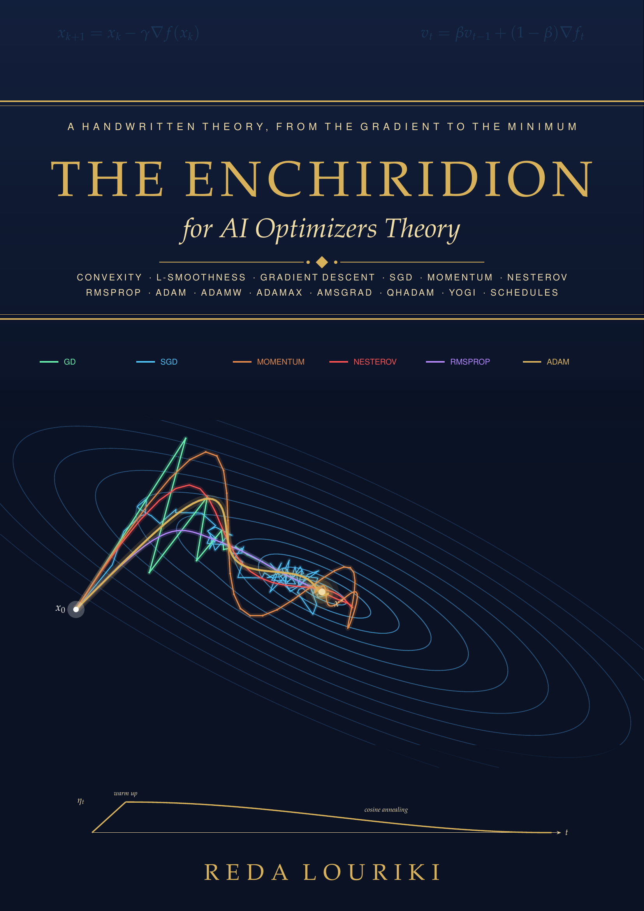
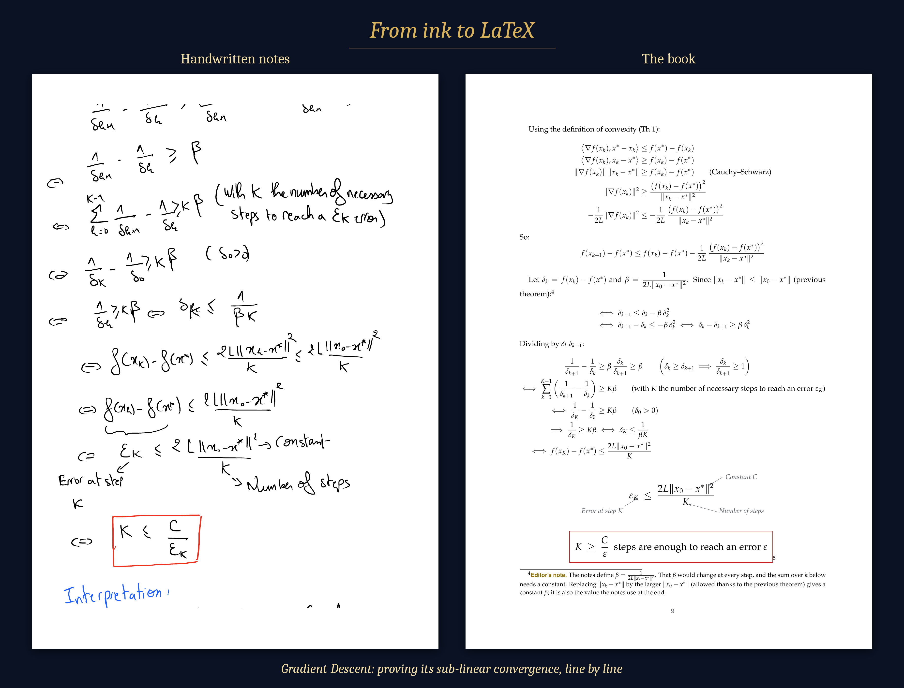

<p align="center">
  
</p>

<h1 align="center">The Enchiridion for AI Optimizers Theory</h1>

<p align="center">
  <i>A handwritten theory of optimization for machine learning, from the gradient to the minimum.</i><br>
  <b>Reda Louriki</b> · The Enchiridion Series, Book II
</p>

<p align="center">
  <a href="The-Enchiridion-for-AI-Optimizers-Theory.pdf"><b>📖 Download the book (PDF, free)</b></a>
</p>

---

## About

Every model we train learns the same way: an optimizer follows the gradient of a loss, one step at a time, trying to reach the minimum. This book is about those steps.

I wrote this theory by hand in May and June 2026, one chapter at a time. It starts with the maths the proofs need (convexity and L-smoothness) and the convergence proof of Gradient Descent. Each later chapter adds one idea to make it faster, more stable or more robust, ending with the optimizers and schedules used to train today's large models.

Each optimizer is introduced through the problem it solves in the previous one. Every proof is written out in full, and every optimizer has a one-line motto:

| Optimizer | Motto |
|---|---|
| Gradient Descent | *Follow the steepest slope directly.* |
| Momentum | *Persist in directions that keep reinforcing themselves.* |
| Nesterov | *See before you leap.* |
| RMSProp | *Normalise each direction by its historical volatility.* |
| Adam | *Use Momentum for direction and RMSProp for scale.* |
| AdamW | *Use Adam but with Weight Decay for generalization.* |

> *Enchiridion* (Greek): "that which is held in the hand", a handbook.

## Contents

| # | Chapter | Highlights |
|---|---------|------------|
| I | Prerequisite | Convexity, the "global minimum formula", positive Hessian, L-Lipschitz & L-smooth functions, descent lemma, co-coercivity |
| II | Gradient Descent | Optimal learning rate `0 < γ < 2/L`, proof of convergence, the `O(1/ε)` rate |
| III | Stochastic Gradient Descent | Unbiased estimator, variance/noise, cost vs. GD, mini-batches, Polyak averaging (ASGD) |
| IV | Momentum & Nesterov | Exponentially weighted average, where the "exponential" comes from (`1/e`), bias correction, PyTorch's form, look-ahead |
| V | RMSProp | Per-direction normalisation, the roles of ε, why divide by a square **root** (dimensional analysis) |
| VI | Adam & AdamW | Why Momentum and RMSProp are both needed, bias correction, L2 regularization vs. decoupled weight decay |
| VII | Other Adam Versions | AdaMax (the ∞-norm), AMSGrad, QHAdam (hyperbolic discounting), Yogi |
| VIII | Learning Rate Schedule | Step decay, exponential decay, cosine annealing, **warm up** |

## From ink to LaTeX

<p align="center">
  
</p>

- **Content:** written by hand by **Reda Louriki**. The explanations, proofs and examples are mine.
- **Typesetting:** the notes were transcribed into LaTeX with the help of AI (**Claude Opus 5.5**). My wording was kept, and only grammar and math errors were corrected.
- **Transparency:** every correction that changes a formula, an index, a number or a conclusion is marked with an **Editor's note** footnote and listed in *Notes on this Edition*. The warm-up section, left unfinished in the notes, was completed in the same spirit and is clearly marked.
- **The cover is real maths:** it shows the actual trajectories of GD, SGD, Momentum, Nesterov, RMSProp and Adam, computed on the same loss landscape from the same starting point (`latex/gen/cover_gen.py`).

## Repository structure

```
.
├── The-Enchiridion-for-AI-Optimizers-Theory.pdf   # the book
├── latex/                  # full LaTeX source
│   ├── main.tex            # entry point
│   ├── preamble-style.tex  # colours, boxes, chapter style
│   ├── cover.tex / backcover.tex / preface.tex
│   ├── ch01-...tex → ch08-...tex
│   ├── appendix-notes.tex  # Notes on this Edition
│   └── gen/                # cover artwork (Python → TikZ) and plot data
└── images/                 # cover and preview images
```

## Build it yourself

You need a TeX distribution (TeX Live or MiKTeX) with `tikz`, `pgfplots`, `tcolorbox`, `lettrine` and `mathpazo`.

```bash
cd latex
pdflatex main.tex
pdflatex main.tex   # second run for the table of contents and the cover overlay
```

To regenerate the cover trajectories (optional; needs `numpy` and `matplotlib`):

```bash
cd latex/gen
python cover_gen.py && python export.py
```

## The series

1. [The Enchiridion for Tree Based Algorithms Theory](https://github.com/YOUR-USERNAME/enchiridion-tree-based-algorithms)
2. **The Enchiridion for AI Optimizers Theory** (this book)

## References

- Kingma & Ba, *Adam: A Method for Stochastic Optimization* (2014): Adam and AdaMax
- Loshchilov & Hutter, *Decoupled Weight Decay Regularization* (2017): AdamW
- Reddi, Kale & Kumar, *On the Convergence of Adam and Beyond* (2018): AMSGrad
- Ma & Yarats, *Quasi-hyperbolic momentum and Adam for deep learning* (2019): QHAdam
- Zaheer et al., *Adaptive Methods for Nonconvex Optimization* (2018): Yogi
- Polyak & Juditsky, *Acceleration of Stochastic Approximation by Averaging* (1992): ASGD
- Nesterov, *A method for solving the convex programming problem with convergence rate O(1/k²)* (1983)
- Loshchilov & Hutter, *SGDR: Stochastic Gradient Descent with Warm Restarts* (2016): cosine annealing
- Vaswani et al., *Attention Is All You Need* (2017), and Liu et al., *On the Variance of the Adaptive Learning Rate and Beyond* (2019): warm up

## Feedback

This is **v1**. If you find an error, have a clearer way to explain something, or want an optimizer added (Lion? Sophia? Shampoo?), please [open an issue](https://github.com/YOUR-USERNAME/enchiridion-ai-optimizers/issues).

If the book helped you, a ⭐ is appreciated.

## License

© 2026 Reda Louriki. Released under [CC BY-NC-SA 4.0](LICENSE): you may share and adapt it with attribution, for non-commercial use, under the same license.
